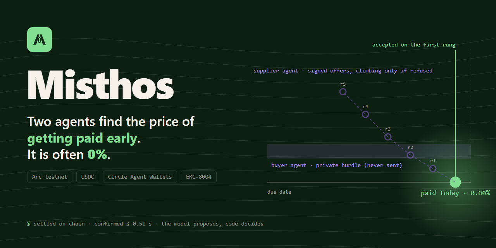
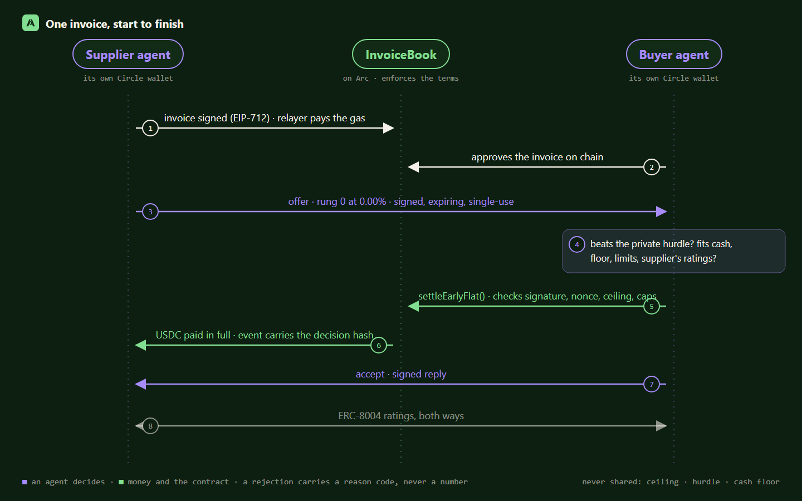

<div align="center">



# Misthos

**Two businesses' agents agree the price of getting paid early. Often 0%.**

An open agent kit for invoice payment timing, settled in USDC on Arc.<br />
The model proposes. Code decides.

[**Live app**](https://misthos-kit.vercel.app) · [**Demo video**](https://youtu.be/9PfQtIN1SnA) · [**Verifiable proofs**](docs/PROOFS.md) · [How it works](#how-it-works) · [Safety model](#safety-model) · [Quick start](#quick-start) · [Docs](#documentation)

[](https://docs.arc.network)
[](https://www.circle.com/usdc)
[](docs/PROOFS.md)
[](#quick-start)
[](agent/tsconfig.json)
[](https://thecanteenapp.com)

</div>

> **Unaudited. Testnet only.** Test USDC only. Do not use funds you cannot lose. No account recovery: lose your wallet, lose your account.

---

## At a glance

| | |
|---|---|
| **On-chain** | **9 invoices** registered on Arc testnet. **8 paid early by the two agents, 7 of them at 0%**, 95.00 test USDC settled. Every transaction links to the explorer below. |
| **Roles** | **5 wallets** registered once and for good on the `RoleRegistry`, including one from MetaMask during the demo. |
| **Agents** | **2 ERC-8004 identities** (supplier agent 897306, buyer agent 897307) and **10 on-chain ratings** written after settlements. |
| **Code** | 69 contract tests, 249 agent tests, 99 backend tests (with a real Anvil chain), 59 frontend tests. |
| **Traction** | **No independent pilot yet.** Everything above was run by the team and is labelled `team` on the site and in [`docs/TRACTION.md`](docs/TRACTION.md). |

Every figure was checked against the chain on 18 Oct 2026: all 46 transactions returned `success`. Full list in [**docs/PROOFS.md**](docs/PROOFS.md).

## Why Misthos

Businesses pay each other late. B2B terms average about 45 days, and the most common reason a customer gives for paying late is its own cash ([Atradius 2025, via Kaplan](https://www.kaplancollectionagency.com/business-advice/54-statistics-on-the-b2b-payment-delays/); secondhand).
A supplier that needs cash sooner pays for it: invoice factoring costs about **26 to 30% a year** ([Fundthrough](https://www.fundthrough.com/blog/invoice-factoring/invoice-factoring-explained-costs-examples-faqs/), [Resolve Pay](https://resolvepay.com/blog/effective-annual-factoring-cost); sellers' own figures), and a 2/10 net 30 discount is about 37% a year.
Meanwhile the buyer often holds idle cash. Each side knows something the other does not: the supplier knows what waiting costs it, the buyer knows what its cash could earn.

Misthos gives each business its own agent:

1. The **supplier agent** starts at **0%** and climbs a short ladder of signed early-pay offers, never past its private ceiling.
2. The **buyer agent** accepts only when the offer beats its private hurdle and fits its cash, its cash floor, its upcoming payments and its exposure limits.
3. The **InvoiceBook** contract checks the signed terms and settles in USDC on Arc in under a second.
4. Nothing private is published: a rejection carries a reason code, never a number.

The mechanism (dynamic discounting) exists in web2: C2FO, Taulia and others. What is new here is two independently run agents finding the price from each side's private bounds, and a contract enforcing what they signed.

## What makes Misthos different

| Player | Who sets the price | An agent on each side | Terms enforced by a contract | Funded by | Settlement | Can clear at 0% |
|---|---|---|---|---|---|---|
| Invoice factoring | ❌ the factor | ❌ | ❌ | the factor | days | ❌ about 26 to 30% a year |
| C2FO | ❌ suppliers bid, an algorithm picks offers that meet the buyer's target | ❌ | ❌ platform | buyer cash, or a funder | platform payment run | ❌ not a design goal |
| Taulia | ❌ the supplier picks a date, a program rate applies | ❌ | ❌ platform | buyer cash or third-party funders | platform payment run | ❌ not a design goal |
| Centrifuge | ❌ pool terms set by originators and investors | ❌ | ✅ on-chain pools | investors in a pool | on chain, pool rules | ❌ not a design goal |
| **Misthos** | **✅ the two businesses' agents negotiate** | **✅ supplier and buyer** | **✅ InvoiceBook checks the signed offer** | **the buyer's own idle USDC, no lender** | **on Arc, under a second** | **✅ often, 7 of 8 settlements** |

Other companies are described from their own public pages (c2fo.com on dynamic discounting, taulia.com, Centrifuge's documentation, and factoring costs from Fundthrough and Resolve Pay). This is a summary of what each says it does, not a test of their products.

**Three things we have not seen combined:**
1. **Two agents, two private ranges.** The supplier's ceiling and the buyer's hurdle never leave their own machines; a deal happens only where they overlap, and a refusal carries a reason code, never a number.
2. **What the agents sign is what the contract enforces.** The offer is EIP-712 signed, single-use and expiring; `InvoiceBook` checks the signature, the rate ceiling and the buyer's caps before any USDC moves.
3. **Trust from the chain, not from a form.** Each wallet's role is fixed on the `RoleRegistry`, the history between two wallets is counted from settlement events, and ERC-8004 ratings can only lower what a buyer agent accepts.

## How it works



| Stage | What happens |
|---|---|
| **Onboarding** · once | Connect a wallet → sign in with a signature (EIP-4361, no gas, no email) → choose **supplier or buyer**, recorded on the `RoleRegistry` for good → set exposure limits → link your agent with a one-time code its wallet signs. |
| **One invoice** · per payment | The supplier signs (EIP-712) and a relayer registers it, paying the gas → the buyer approves on chain → the supplier agent sends signed, expiring, single-use offers from 0% → the buyer agent answers accept, or reject with a reason code → on accept its Circle Agent Wallet calls `settleEarlyFlat` → both agents rate each other on ERC-8004. |
| **Owner controls** · any time | **Agent chat** (plain words in, a fixed set of actions out; anything that moves money waits for a one-time confirmation) · **Trust card** (both parties' on-chain roles, paid history between the pair, duplicate and first-time flags, each with its source) · signed **decision log** · **shadow report** (try it on your own invoices; nothing uploaded). |

## Safety model

Anything unknown, unreadable or malformed **fails closed**: the agent accepts nothing and says why.

| Guarantee | How it is enforced |
|---|---|
| **The model never touches funds** | The model only fills a strict schema. Code clamps every number into the owner's bounds; no model output reaches a signer or a contract call. |
| **Terms are enforced on chain** | `InvoiceBook` checks the supplier's signature (EOA or ERC-1271), a single-use offer nonce, the rate ceiling, the buyer's per-invoice and daily caps, net + discount = face, and settles an invoice at most once. It never holds funds. |
| **A wallet is one role, for good** | `RoleRegistry` records supplier or buyer once, with no owner, upgrade or reset. The site and the relayer refuse any action that does not match. |
| **Money waits for a yes** | In the agent chat, every payment is described in exact numbers and runs only with a one-time code, within two minutes, exactly as described. |
| **Wrong vendor** | The payout address is the invoice's own supplier, fixed on chain; a first payment to a new address is held; a forwarded claim link cannot redirect it. |
| **Fake or duplicate invoice** | Nothing is paid before the buyer approves on chain; a possible duplicate is flagged and refused at registration. |
| **Retry pays twice** | Single-use nonce, one settlement per invoice, stable idempotency keys, one shared decision for offers that arrive together. |
| **Auditable decisions** | Every decision is hash-chained, signed by the agent's wallet and carries a salted commitment to its private inputs, so the owner can replay and prove it later. |
| **Exact money** | Amounts are `bigint` minor units (6 decimals) everywhere; floats only at the display edge. |

Threats, limits and trade-offs: [`docs/DECISIONS.md`](docs/DECISIONS.md), [`docs/DATA_AUDIT.md`](docs/DATA_AUDIT.md).

## Circle and Arc integration

| Product | How Misthos uses it |
|---|---|
| **Arc** | Settlement layer. USDC is the gas token and finality is sub-second: the explorer shows settlements confirmed within 0.51 s. |
| **Circle Agent Wallets** | Each agent has its own Circle Agent Wallet, operated through the Circle CLI. Agents sign offers, decisions and settlements without holding a raw key. |
| **USDC** | The unit of every invoice, offer, cap and payment. |
| **ERC-8004** (Arc's registries) | Each agent has an identity; each rates the other after a settlement; the buyer reads the supplier's ratings before accepting, and they can only lower what it accepts. |

## Deployed contracts (Arc testnet, chain id 5042002)

| Contract | Address | Deploy transaction |
|---|---|---|
| **InvoiceBook** (current) | [`0x108DA05Fec74a1c0620CF7D66D07AeB586A5288C`](https://explorer.testnet.arc.io/address/0x108DA05Fec74a1c0620CF7D66D07AeB586A5288C) | [`0x2d0204bc…99ce`](https://explorer.testnet.arc.io/tx/0x2d0204bca37f6c07420d02e8e5912a782b90a679cd00279b4a9516aeddad99ce) · block 67164103 |
| **RoleRegistry** | [`0x54C789EcA2d40ef902CF792077622AA7B5a901dC`](https://explorer.testnet.arc.io/address/0x54C789EcA2d40ef902CF792077622AA7B5a901dC) | [`0x9769ea74…ee75`](https://explorer.testnet.arc.io/tx/0x9769ea74eb2a53c8b42142b5555f50b7874e98dd4c5537653ac9e5f95ee8ee75) · block 67192949 |
| InvoiceBook v1 (superseded: the Circle CLI cannot pass a struct argument, so v2 added `settleEarlyFlat`) | [`0xd62B53a4d3a7Cc56467F75cdA8dA246eA2aB35ED`](https://explorer.testnet.arc.io/address/0xd62B53a4d3a7Cc56467F75cdA8dA246eA2aB35ED) | [`0xdcfb3799…bf72`](https://explorer.testnet.arc.io/tx/0xdcfb3799e99a3611d486765d7e45935ca2761f57bc4ae2d5218331c7e9ddbf72) |
| USDC (Arc native) | [`0x3600000000000000000000000000000000000000`](https://explorer.testnet.arc.io/address/0x3600000000000000000000000000000000000000) | |
| ERC-8004 Identity Registry | [`0x8004A818BFB912233c491871b3d84c89A494BD9e`](https://explorer.testnet.arc.io/address/0x8004A818BFB912233c491871b3d84c89A494BD9e) | |
| ERC-8004 Reputation Registry | [`0x8004B663056A597Dffe9eCcC1965A193B7388713`](https://explorer.testnet.arc.io/address/0x8004B663056A597Dffe9eCcC1965A193B7388713) | |

| Account | Address |
|---|---|
| Supplier agent (Circle Agent Wallet, ERC-8004 id 897306) | [`0x6afd3cac8e4ac3d15388b58ac999481c96ffdf6f`](https://explorer.testnet.arc.io/address/0x6afd3cac8e4ac3d15388b58ac999481c96ffdf6f) |
| Buyer agent (Circle Agent Wallet, ERC-8004 id 897307) | [`0x156af8e7298fc862c54b8d72b2b232770ceefa15`](https://explorer.testnet.arc.io/address/0x156af8e7298fc862c54b8d72b2b232770ceefa15) |
| Relayer (pays registration gas) | [`0xd8d88a6ef074004c308e240bd7f2499363e80c8d`](https://explorer.testnet.arc.io/address/0xd8d88a6ef074004c308e240bd7f2499363e80c8d) |
| Deployer, contract owner and fee recipient | [`0xe56357E6eFe146a33223Dd90f11bCA992C1B137C`](https://explorer.testnet.arc.io/address/0xe56357E6eFe146a33223Dd90f11bCA992C1B137C) |

## Live proof (real Arc testnet transactions)

### Invoices: registered, approved, paid early

| Invoice | USDC | Result | Registered | Approved | Settled |
|---|---|---|---|---|---|
| `0xc0a324c9…` | 25.00 | paid early at **2.00%** | [`0x5a587ee1…6af3`](https://explorer.testnet.arc.io/tx/0x5a587ee1607d2b5df2a895fea9f4c2d59905be3b733c62a7ec420cd441ff6af3) | [`0xd9b56b5f…a3e6`](https://explorer.testnet.arc.io/tx/0xd9b56b5f74bd12e37cc717f930ed389cb046180c2d6b028e6fae50a036a5a3e6) | [`0x8d581c6a…c8a1`](https://explorer.testnet.arc.io/tx/0x8d581c6a48fcb14892ea647405a9370d274d80dfb9e9f7459241da1bee3ec8a1) |
| `0x7b1fca0a…` | 40.00 | paid early at **0.00%** | [`0xfcd91b74…d4b2`](https://explorer.testnet.arc.io/tx/0xfcd91b745dbaaae5adc7cd4cf7bb4a549c59043ff5ff33e0954376766a57d4b2) | [`0x689d375d…90d3`](https://explorer.testnet.arc.io/tx/0x689d375d1ba7ac8da030b152142437f7be12dd6eabc76784db8e6552df2990d3) | [`0x7f0e6735…8119`](https://explorer.testnet.arc.io/tx/0x7f0e67359180504dd7b00455fc85c542d43b7389536bfdb456c313f9df0c8119) |
| `0x50694ca4…` | 5.00 | paid early at **0.00%** | [`0x0e8dbe12…3942`](https://explorer.testnet.arc.io/tx/0x0e8dbe12c8cea39fa10f7faa406f37c53f76e74cc71844083012ae1dffb73942) | [`0x28553e98…7554`](https://explorer.testnet.arc.io/tx/0x28553e98c7cbadcdbec4c58770908b35bca90f0d94d7dc7fb67366b5eddb7554) | [`0x7541b1c9…48e0`](https://explorer.testnet.arc.io/tx/0x7541b1c911edc89a7d84c859619aa4a7c2df49579541a3269a3dc748648748e0) |
| `0x120edd9f…` | 5.00 | paid early at **0.00%** | [`0x41deec13…2fda`](https://explorer.testnet.arc.io/tx/0x41deec1327b767f05c3569047cb5407f596eb1eb6ceba5ff811436ec70022fda) | [`0xde55fcd8…6e5f`](https://explorer.testnet.arc.io/tx/0xde55fcd8b0b1fa180bea75a02c5f4b6ecf2a01ba5a0ddbdbdc30d5255bce6e5f) | [`0xf2304a1d…d13a`](https://explorer.testnet.arc.io/tx/0xf2304a1dcfdbc1d774530a69d8b6dcef8c85d1bfd64187e9165d797dedefd13a) |
| `0x02e86fd1…` | 5.00 | paid early at **0.00%** | [`0x1cc59094…14a4`](https://explorer.testnet.arc.io/tx/0x1cc59094c2011ded5375b8863db2bbfd8b02f0beffb1b22cb4d4647ede5014a4) | [`0xe5fccf03…5d36`](https://explorer.testnet.arc.io/tx/0xe5fccf03544be14293f3321aa5b13cee6cb67f1f75d7b9a68539a89b69625d36) | [`0x6a74a2ac…97ce`](https://explorer.testnet.arc.io/tx/0x6a74a2ac7f6c1a092ff151da9f871e2cb9284fa653cedfd207b2fb08523197ce) |
| `0x0fcc4980…` | 5.00 | paid early at **0.00%** | [`0xf7595ddb…8f67`](https://explorer.testnet.arc.io/tx/0xf7595ddba8e086b0e2f8f9e5d5cb2ae0c4dd9eede19382f9e600643811298f67) | [`0xfadd4963…422b`](https://explorer.testnet.arc.io/tx/0xfadd496321828f59d5d99e74cf2f2d2d017202778f167051bcdfe7b726a1422b) | [`0x018260a3…5b27`](https://explorer.testnet.arc.io/tx/0x018260a33832ece6068ac15f28c06ca77b4d2976a14ed8db0e5168229c035b27) |
| `0x4d09110c…` | 5.00 | paid early at **0.00%** | [`0x72ab5eab…933f`](https://explorer.testnet.arc.io/tx/0x72ab5eab0bd1056deb9127184d2323cafc25731a2296259a24ddcef4c86b933f) | [`0xa678cc0a…d797`](https://explorer.testnet.arc.io/tx/0xa678cc0ad8b67b5c38dc7d4062d9f7a83c79ea066e1bcc2afdbf4d4fd374d797) | [`0x8f3979ab…e7e1`](https://explorer.testnet.arc.io/tx/0x8f3979ab6f3ba079d63e667c48db6b79c93f059d5d2d0e36a07ebdfdbf6ce7e1) |
| `0xce401415…` | 5.00 | approved, not yet negotiated | [`0x76a176a7…d5be`](https://explorer.testnet.arc.io/tx/0x76a176a76fa76700f053de9876bb083a9485c5321f2c675467f9b54f3a4ad5be) | [`0xd2f6e06c…4036`](https://explorer.testnet.arc.io/tx/0xd2f6e06c94ad226079c4569b8be7f02581228dcc58926ec536109d20ddce4036) | – |
| `0xe67d3108…` | 5.00 | paid early at **0.00%** | [`0xa56f7287…ea1b`](https://explorer.testnet.arc.io/tx/0xa56f7287d8fd7030e7bab1ed9bfa028e2cf8eac5be0d1e816fdd24730d3cea1b) | [`0xb8a99a37…fc87`](https://explorer.testnet.arc.io/tx/0xb8a99a37536bfbea06a8f3dd8f146e36137deb3806935a42c8bb0cb92919fc87) | [`0x2ffadfdc…d403`](https://explorer.testnet.arc.io/tx/0x2ffadfdcc03f0ff20f1a0c4625b6f53c0eb8f8cf21bf84a15d6199c5808bd403) |

The first invoice cleared at 2% before we fixed a bug that let the model raise the opening rate; every one since cleared at 0%.

### Roles: each wallet chose once

| Wallet | Address | Role | Transaction |
|---|---|---|---|
| Supplier agent (Circle Agent Wallet) | [`0x6Afd3C…dF6f`](https://explorer.testnet.arc.io/address/0x6Afd3CAC8e4aC3D15388b58Ac999481c96FfdF6f) | **supplier** | [`0x2c4e7370…4fce`](https://explorer.testnet.arc.io/tx/0x2c4e7370dbd8f0816a724baa3795baa6d611b50b8af65d8bfc1588f5e7194fce) |
| Buyer agent (Circle Agent Wallet) | [`0x156AF8…FA15`](https://explorer.testnet.arc.io/address/0x156AF8E7298fc862C54B8D72b2b232770ceEFA15) | **buyer** | [`0x94f96ae3…4d05`](https://explorer.testnet.arc.io/tx/0x94f96ae377810a66653e69eae1193c7c095d052c61b02389c2b1f9b49b6e4d05) |
| Supplier owner wallet (team test wallet) | [`0xC4Ff3f…81E7`](https://explorer.testnet.arc.io/address/0xC4Ff3f0dC60c5f3a9bab7582Ce862D8c84bB81E7) | **supplier** | [`0x2c3ecccf…d5ae`](https://explorer.testnet.arc.io/tx/0x2c3ecccfa4cb7794272808feb544343a700cf9401b77c774819b14d4d120d5ae) |
| Buyer owner wallet (team test wallet) | [`0x057106…776a`](https://explorer.testnet.arc.io/address/0x057106d6bD43a3c7a03fB07E2049b64Ba7e0776a) | **buyer** | [`0xcab56be4…bd02`](https://explorer.testnet.arc.io/tx/0xcab56be41ff0c5e084a44278735d7559be9fdce293eefb15ebf616cd5e3abd02) |
| Owner's MetaMask (registered live in the demo) | [`0xA50050…9130`](https://explorer.testnet.arc.io/address/0xA50050DBDBe672a5F0261e403909bCB8590B9130) | **supplier** | [`0xfb8d9c7e…2ed7`](https://explorer.testnet.arc.io/tx/0xfb8d9c7ef63b347d9046b1a4cc57c78dc5d3ebd4aa1fad9c9d970ac569352ed7) |

### Agent identity and reputation (ERC-8004)

2 identity registrations and 10 ratings, all listed with their transactions in [`docs/PROOFS.md`](docs/PROOFS.md). **These ratings come from agents we run**: they show the mechanism works, not independent reputation.

## Tech stack

| Layer | Technology |
|---|---|
| Settlement | Arc testnet (chain id 5042002), USDC-native gas |
| Circle | Agent Wallets via the Circle CLI |
| Contracts | Solidity, Foundry (unit, fuzz and invariant tests), EIP-712, ERC-1271 |
| Agents | TypeScript, viem, zod; Groq `openai/gpt-oss-120b` behind a strict-schema harness; AES-256-GCM vault for private settings |
| Identity | ERC-8004 identity and reputation registries on Arc |
| Backend | Hono, Postgres (PGlite locally), chain indexer, relayer, EIP-4361 sign-in, signed agent reads |
| Web | Next.js 16 (App Router), Tailwind 4, three.js scene, wallet via EIP-6963 |
| Hosting | Vercel (website). Backend and agents run locally for now. |

## Judging criteria

| Criterion | Where to look |
|---|---|
| **Agentic sophistication** | Two independent agent processes negotiate with signed messages; each decides from private bounds; a text interface maps plain words to a fixed set of actions with confirmations; every decision is signed and replayable. |
| **Traction** | Honest: no independent pilot yet. 8 team-run settlements on Arc, 5 registered wallets and a pilot kit ready for the first outside business (`docs/PILOT_GUIDE.md`). |
| **Circle tool usage** | Arc settlement, Circle Agent Wallets for both agents, USDC throughout, ERC-8004 on Arc. |
| **Innovation** | Two-sided agent price discovery that often clears at 0%, on-chain enforcement of what the agents signed, a permanent role registry, and a trust card built only from verifiable data. |

## Quick start

**Use it:** open the [live app](https://misthos-kit.vercel.app), connect MetaMask on Arc testnet (the site adds the network), sign in and choose your side. The live site runs without the backend for now (public pages, roles, the shadow report); the full flow with agents runs locally.

**Run it locally** (Node 22+, pnpm, Foundry):

```bash
pnpm install
pnpm --filter @misthos/agent doctor          # what is missing for a real run
pnpm dev                                     # site on :3000
pnpm --filter @misthos/backend start         # API, indexer, relayer on :4000
pnpm --filter @misthos/agent supplier        # supplier agent on :4101
pnpm --filter @misthos/agent buyer           # buyer agent on :4102
```

Create a real invoice between the two agent wallets and watch them negotiate:

```bash
cd agent && pnpm exec tsx scripts/testnet-invoice.ts 5 30    # prints INVOICE_ID
# then in the site's agent chat: "negotiate 0x<first 10 characters>" and Confirm
```

Setup in order (Circle login, faucet, deploy, model key): [`docs/SETUP.md`](docs/SETUP.md). Environment variable names only, never values: `.env.example` in each package.

**Verify the build:**

```bash
cd contract && forge test                    # 69 tests
pnpm --filter @misthos/agent test            # 249 tests
pnpm --filter @misthos/backend test          # 99 tests, real Anvil chain
pnpm --filter @misthos/frontend test         # 59 tests
```

## Repository layout

```
contract/   InvoiceBook and RoleRegistry (Foundry), deploy scripts, deployments
agent/      core library, negotiation protocol, Circle wallet adapter, the two agent processes,
            text agent, shadow mode, audit tools
backend/    REST API, chain indexer, relayer, wallet sign-in (Hono + Postgres)
frontend/   the website (Next.js 16)
docs/       decisions, proofs, data audit, market research, pilot kit, hosting, setup, the build spec
```

## Documentation

| Document | Purpose |
|---|---|
| [`docs/PROOFS.md`](docs/PROOFS.md) | Every on-chain transaction, checked against the chain |
| [`docs/DECISIONS.md`](docs/DECISIONS.md) | Decision record, including what went wrong and what is unverified |
| [`docs/SETUP.md`](docs/SETUP.md) | Accounts, wallets and a real run, in order |
| [`docs/HOSTING.md`](docs/HOSTING.md) | Vercel and Render, step by step |
| [`docs/DATA_AUDIT.md`](docs/DATA_AUDIT.md) | What is public, what the server holds, what stays with each agent |
| [`docs/MARKET_RESEARCH.md`](docs/MARKET_RESEARCH.md) | Market and sources, with confidence ratings |
| [`docs/TRACTION.md`](docs/TRACTION.md) | How activity is labelled: pilot, team, unverified |
| [`docs/PILOT_GUIDE.md`](docs/PILOT_GUIDE.md) | How a second business joins |
| [`contract/DEPLOYMENTS.md`](contract/DEPLOYMENTS.md) | Deployment history |

## Status and limits

- **Testnet only and unaudited.**
- **No independent user yet**; all activity is team-run and labelled so.
- **Only the website is hosted.** The backend and agents run locally; the demo shows the full system on localhost against Arc testnet.
- `InvoiceBook` does not consult the `RoleRegistry`; the site and relayer enforce roles, so a direct contract call between wrongly-roled wallets is still possible (the Trust card shows it).
- Each Circle CLI signature spawns a process; on an 8 GB laptop one negotiation takes minutes, although the chain confirms in under a second.
- Agent Wallet spending policies are mainnet-only, so spending caps live in our contract.
- The site's content security policy allows `'unsafe-inline'` scripts (partial XSS protection).

## Credits

Built for the **Tameion Agents Hackathon**, hosted by [Canteen](https://thecanteenapp.com) with [Circle](https://www.circle.com) and [Arc](https://docs.arc.network).
Language model inference by [Groq](https://groq.com).

Built by **Thameemul Azarudeen N**. MIT licensed.
